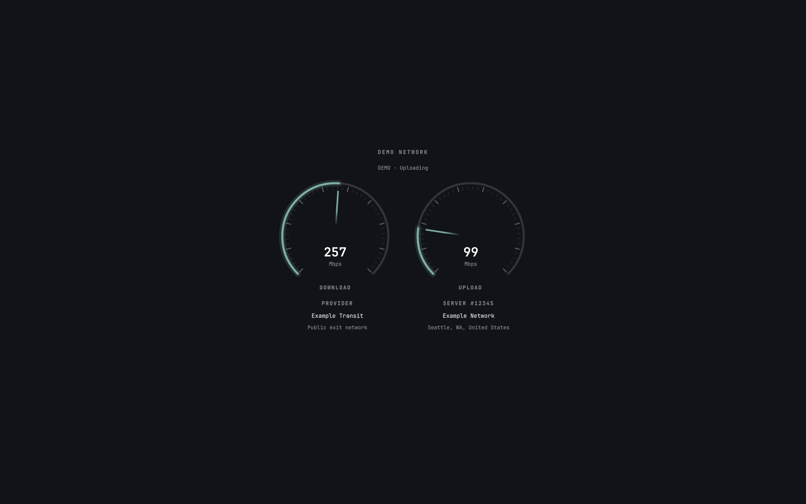

# Speedtest

Ookla Speedtest with Omarchy’s original dials and provider/server details. Open it from the network panel’s **Speed Test** button.

[简体中文](README.zh-CN.md)



## Install

Requires Omarchy Quattro 4.0.5+, Python 3.10+ and [Ookla’s official CLI](https://www.speedtest.net/apps/cli) 1.2.0+ (`speedtest`, not Python `speedtest-cli`). Place the CLI on PATH or at `~/.local/bin/speedtest`, then run it once to review its terms.

From this repository:

```bash
git clone https://github.com/imzihuailin/speedtest-map.git
cd speedtest-map
python install.py
```

Installation links the source directory into Omarchy and replaces the existing speed-test entry. Keep the repository in place; rerun the installer after moving it. System files remain untouched.

Esc or clicking the background stops testing. Enter reruns a completed test. With a proxy, the provider shown is the public exit network.

## Remove

```bash
python install.py --uninstall
```

Restores the previous entry and preserves source code and the CLI. Add `--purge` to remove plugin settings. Keep `~/.local/state/speedtest-map/install.json` until uninstalling.

## Settings

Optional: `~/.config/speedtest-map/config.json` (XDG paths supported).

```json
{"cliPath":"speedtest","reducedMotion":false}
```

## Development

```bash
python install.py --demo    # Install without requiring the CLI
python dev.py --demo        # Offline preview and source watcher
python dev.py               # Real testing and source watcher
```

Reloading recreates the bar/services and closes open plugin panels. Ctrl+C closes the preview.

```bash
python -m unittest discover -s tests -p 'test_*.py'
node tests/model.test.cjs
omarchy plugin validate .
python tools/qml_smoke.py   # Optional on-screen integration tests
python tools/preview.py     # Generate preview.png with synthetic data
```

[Validation results](VALIDATION.md) · [GPL-3.0-only license](LICENSE.md) · [Credits](THIRD_PARTY_NOTICES.md)
